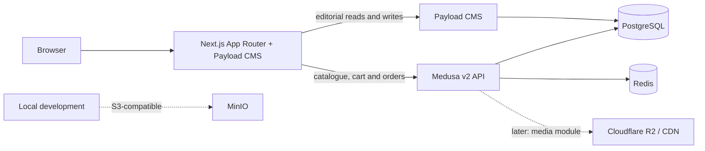

# Lopaworld architecture

## Phase 0 foundation



The storefront and Payload admin/API run in `apps/storefront`; Medusa server and its worker run together in shared worker mode during local development (`apps/medusa`). PostgreSQL is shared as a server but uses the isolated `payload` schema for CMS tables. Redis backs Medusa sessions and can be used by its event, workflow and locking modules when configured. Production will run Medusa server and worker as separate processes.

No application has been wired to R2 yet. MinIO is provided for local S3-compatible development; production media storage configuration is a later phase.

## Data ownership

- Medusa owns products, variants, prices, inventory, carts, promotions, orders and regions.
- Medusa product labels use the controlled seven-slug set in `@lopaworld/types`; the assignment is stored as product metadata and validated when a product is published. Categories remain editable Medusa product categories.
- Published Medusa products require a valid label, images with alternative text, at least one complete option/variant, and a positive NGN price for every variant. Draft products can be incomplete while being edited.
- Payload owns labels' editorial pages, campaigns, stories, size guides, content pages and homepage composition. Payload references commerce entities by Medusa handle or ID. It must never copy prices or stock.
- Payload homepage content is an ordered `blocks` field and has a draft preview route. Uploaded media is marked with rights confirmation before it can be selected for campaign or label hero fields.
- Secrets are read from environment variables and are not included in client bundles.

## Checkout and payment (Phase 4)

```mermaid
sequenceDiagram
  participant Customer
  participant Storefront as Next.js server
  participant Medusa
  participant Paystack
  Customer->>Storefront: Save contact and NG delivery address
  Storefront->>Medusa: Update cart, request shipping options and calculate prices
  Customer->>Storefront: Select delivery option
  Storefront->>Medusa: Add shipping method and retrieve final cart total
  Storefront->>Medusa: Create Paystack session from Medusa cart
  Medusa->>Paystack: Initialize hosted transaction (server-side)
  Paystack-->>Customer: Hosted authorization page
  Paystack-->>Medusa: Signed webhook (when configured)
  Customer-->>Storefront: Return from hosted checkout
  Storefront->>Medusa: Complete cart; Medusa provider verifies reference, NGN amount and status
  Medusa-->>Storefront: Order only after successful provider verification
```

The Paystack module lives in `packages/payment-paystack` and is registered only when its secret, callback URL and approved channels are present. Checkout displays the provider only when Medusa reports it enabled for the cart region. The browser never supplies a payable amount or proof of payment. NGN is the only enabled currency. Keep credentials out of the browser and use only test keys for test-mode checkout.

Medusa shipping options are the source of rates. Calculated-price options use Medusa's calculate route before they are presented; the selected method is attached to the cart before the final total is displayed. No options appear until Medusa has owner-configured coverage. `packages/logistics` defines the adapter boundary for future rate, shipment, tracking and cancellation integrations; it does not currently connect to a courier. Order confirmation can recover a completed order for the originating cart and email, but customer tracking and transactional emails still need their owner-confirmed service and identity details.

Phase 2 configuration lives in `apps/storefront/src/collections`, `apps/storefront/src/globals` and `apps/medusa/src/utils/product-validation.ts`. Synthetic seven-label examples live only in `seed/demo-labels.json`; they are never auto-imported and are not approved Lopaworld copy.

## Shared design system (Phase 1)

Design tokens live in `packages/ui/tokens/tokens.css`; components and their accessible interaction patterns live in `packages/ui`. Tailwind v4 reads aliases for the central CSS variables in the storefront's `globals.css`. All seven label themes use the same provisional accent-token structure; actual brand colours remain `TODO_CONFIRM:`. Bodoni Moda and DM Sans are self-hosted variable fonts, with Noto Serif used only when a required glyph is unavailable in the primary face.

## Local service endpoints

| Service | Endpoint |
| --- | --- |
| Storefront and Payload admin | `http://localhost:3000` and `/admin` |
| Medusa API and admin | `http://localhost:9000` and `/app` |
| MinIO S3 API / console | `http://localhost:9002` / `http://localhost:9003` |
| PostgreSQL | `localhost:5432` |
| Redis | `localhost:6379` |

## Decision log

See [DECISIONS.md](DECISIONS.md). Update the architecture diagram and this page when service boundaries or data ownership change.

## Customer engagement (Phase 5, partial)

Guest order lookup is served by Medusa at `POST /store/orders/lookup` and proxied through the storefront at `POST /api/track-order`. It requires both the numeric order number and the checkout email, compares the email server-side, and returns only the order, payment and fulfilment status fields. It does not expose addresses, items or courier tracking details. The order number format shown to customers still needs confirmation against the live Medusa deployment.

Wishlist state currently lives in the browser's local storage and is device-specific. Customer accounts, server-synced wishlist, saved addresses and account order history are not implemented yet. Newsletter and back-in-stock collection/dispatch require an approved provider, consent language and persistence/rate-limit policy before activation. WhatsApp support remains hidden until Lopaworld confirms its official number and customer-service workflow.
