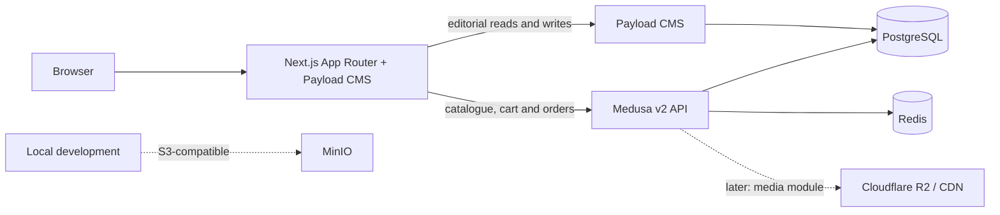

# Lopaworld architecture

## Phase 0 foundation

The storefront and Payload admin/API run in `apps/storefront`; Medusa server and its worker run together in shared worker mode during local development (`apps/medusa`). PostgreSQL is shared as a server but uses the isolated `payload` schema for CMS tables. Redis backs Medusa sessions and can be used by its event, workflow and locking modules when configured. Production will run Medusa server and worker as separate processes.

No application has been wired to R2 yet. MinIO is provided for local S3-compatible development; production media storage configuration is a later phase.

## Data ownership

- Medusa owns products, variants, prices, inventory, carts, promotions, orders and regions.
- Payload owns editorial content and references commerce entities by Medusa handle or ID. It must never copy prices or stock.
- Secrets are read from environment variables and are not included in client bundles.

## Local service endpoints

| Service | Endpoint |
| --- | --- |
| Storefront and Payload admin | `http://localhost:3000` and `/admin` |
| Medusa API and admin | `http://localhost:9000` and `/app` |
| MinIO S3 API / console | `http://localhost:9002` / `http://localhost:9003` |
| PostgreSQL | `localhost:5432` |
| Redis | `localhost:6379` |

## Decision log

See [DECISIONS.md](DECISIONS.md). Update the architecture diagram and this page when service boundaries or data ownership change.
