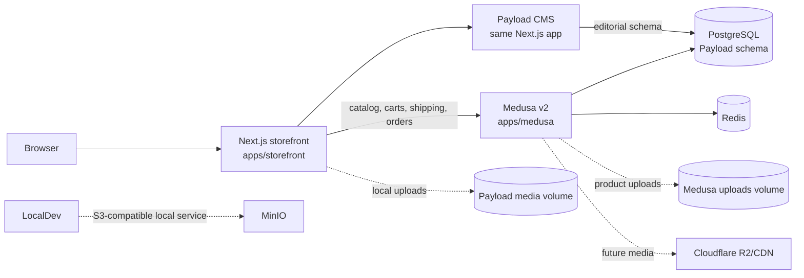

# Lopaworld engineering handoff

**Status snapshot: 5 November 2026**  
**Audience:** incoming engineer, developer, or coding agent  
**Purpose:** explain what exists, how it fits together, how to work on it safely, and what still blocks a real launch.

This is the main handoff document. Use it as the project map, then follow the linked runbooks for exact operational procedures. It distinguishes implemented code from owner-approved business content and from production infrastructure that has only been prepared on paper.

## Read in this order

1. This handoff for current status, architecture, and next actions.
2. [Local development runbook](RUNBOOK.md) for setup and commands.
3. [Architecture](ARCHITECTURE.md) and [decision log](DECISIONS.md) before changing service boundaries or data ownership.
4. [Owner inputs and open decisions](OPEN_ITEMS.md) before adding public claims, catalog data, policies, integrations, or brand assets.
5. [Coolify/Contabo deployment guide](COOLIFY-CONTABO.md) and [launch plan](LAUNCH-PLAN.md) before infrastructure work.
6. [Phase 7 QA checklist](PHASE-7-QA-CHECKLIST.md) before proposing launch readiness.

## Executive status

Lopaworld is a pnpm TypeScript monorepo for a mobile-first Nigerian fashion storefront covering seven labels. It has a Next.js storefront with Payload CMS, a Medusa v2 commerce backend, a shared PostgreSQL service, Redis, a shared design system, payment/logistics integration boundaries, local development Compose, and a drafted Coolify deployment stack.

The implementation includes the storefront route structure, CMS schemas and homepage blocks, catalog/cart/checkout foundations, a configuration-gated Paystack provider, guest order lookup, opt-in GA4 loading, sitemap/feeds, security checks, and a local set of Instagram-derived visual reference images. These are application foundations; they do **not** mean that the shop has an approved production catalog, functioning live checkout, cleared media, or a production deployment.

### Current blockers and limits

- **Local Payload database connection is broken.** A connection attempt to the local PostgreSQL service was rejected with PostgreSQL `28P01` (password authentication failure). The storefront can return HTTP 200, but its homepage displays “Homepage content is temporarily unavailable.” No Payload baseline migration exists; `apps/storefront/src/migrations` currently contains only its README.
- **Next.js security upgrade is required.** The lockfile-resolved Next.js 16.4.0 displayed a security warning. Its production build stopped with a security-fatal upgrade notice. Development mode continued after displaying the notice, so local preview is not evidence that production builds are healthy. Resolve this before deployment; coordinate any upgrade across `pnpm-lock.yaml`, package versions, and CI.
- **Medusa image build has not been verified on Linux.** A prior build on the Windows workspace failed in the installed dependency tree (`emittery` could not find `maps.js`). A clean Linux build in Coolify is still required; treat this as an unresolved compatibility issue, not as a proven Coolify failure.
- **Coolify deployment files are preparation only.** `docker/storefront.Dockerfile`, `docker/medusa.Dockerfile`, and `coolify.compose.yaml` exist, but there is no configured Contabo VPS, Coolify project, DNS cutover, staging acceptance, production secret store, backup destination, or successful production deployment.
- **The Compose stack runs one Medusa service.** It does not yet implement the server/worker separation described as the intended production architecture. Review Medusa worker mode, scaling, and queue behavior before treating this Compose deployment as production-ready.
- **No production Payload migration, CMS content, approved Medusa catalog, region, shipping options, payment onboarding, transactional email, production media storage, monitoring, or tested backups are present.** See [OPEN_ITEMS.md](OPEN_ITEMS.md).
- **Social image rights are not independently confirmed.** The local image manifest explicitly requires rights confirmation before production use.
- **A Git change may exist from starting Next.js.** `apps/storefront/next-env.d.ts` is generated/Next-managed; inspect its diff and preserve the framework-managed instructions. Do not discard workspace changes without checking their source.

## System map



The diagram represents intended and current boundaries, with dotted integrations clearly marked as not wired into production. MinIO is started by local Compose, but the S3 variables are not a completed object-storage integration. R2/CDN is a future production target, not configured code.

### Source-of-truth boundaries

| Data | Owner | Notes |
|---|---|---|
| Products, options, variants, prices, stock, carts, shipping options, payment state, orders, regions | Medusa | Storefront uses the Medusa Store API. Payload may keep handles/IDs for editorial placement, never copied prices or inventory. |
| Labels' editorial pages, campaigns, stories, size guides, general pages, homepage layout, announcement bar, SEO defaults, media rights metadata | Payload | Payload tables use the PostgreSQL schema named `payload`. Public reads are published-only where configured. |
| Seven canonical label IDs | `@lopaworld/types` | `next`, `trybe`, `prime`, `men`, `fashion`, `bridal`, `lopaworld`. These are controlled identifiers; business descriptions and category assignments still need approval. |
| Wishlist | Browser local storage | Device/browser-specific; no server sync, account linkage, or cross-device persistence. |
| Guest order lookup | Medusa endpoint via storefront proxy | Requires order number and checkout email; intentionally returns status summary only, not addresses or line items. |

## Repository map

| Path | Responsibility |
|---|---|
| `apps/storefront` | Next.js App Router storefront, Payload admin/API/config, CMS schemas, public routes, server API routes, browser components, SEO/feeds. |
| `apps/medusa` | Medusa v2 configuration, custom product publish validation, order lookup endpoint, startup seed script. |
| `packages/types` | Shared label identifiers, product metadata contract, analytics event schema. |
| `packages/ui` | Design tokens, fonts, shared UI exports, contrast and font-glyph scripts. |
| `packages/payment-paystack` | Custom Medusa payment provider; only registered when its configuration is complete. |
| `packages/logistics` | Logistics adapter boundary/stub; no courier API integration or shipment workflow. |
| `seed` | Synthetic local demo label data. Never approved production copy; no automatic import. |
| `docker-compose.yml` | Local PostgreSQL, Redis, and MinIO services with named volumes. |
| `coolify.compose.yaml` | Draft Coolify production composition: PostgreSQL, Redis, Medusa, storefront and named persistent volumes. |
| `docker/*.Dockerfile` | Production image build definitions for storefront and Medusa. Validate them on clean Linux before release. |
| `docs/` | Architecture, decisions, runbooks, unresolved owner inputs, launch QA, deployment guide, and this handoff. |
| `e2e/`, `playwright.config.ts` | Playwright/axe checks for developer design galleries. Full storefront commerce E2E coverage is still open work. |
| `.github/workflows/ci.yml` | GitHub Actions quality workflow for install, font checks, typecheck, lint, token contrast, Playwright/axe, and build. A configured workflow is not proof of a recent green run. |

### Storefront route areas

- **Commerce discovery:** `/`, `/shop`, `/new-in`, `/search`, `/labels`, `/l/[label]`, `/l/[label]/[category]`, `/c/[category]`, `/occasions/[slug]`, `/p/[handle]`.
- **Editorial/content:** `/stories`, `/stories/[slug]`, `/pages/[slug]`, `/preview/homepage`.
- **Customer flows:** `/bag`, `/checkout`, `/checkout/return`, `/checkout/confirmation/[orderId]`, `/track-order`, `/wishlist`.
- **CMS/admin:** `/admin`; Payload API is mounted under the Payload route group.
- **Discovery/SEO:** `/sitemap.xml`, `/robots.txt`, `/feeds/google.xml`, `/feeds/meta.xml`.
- **Developer-only galleries:** `/dev/ui`, `/dev/type`; these are intended for development and return 404 in production.

### Important backend routes

- Storefront routes proxy cart, checkout, shipping, payment, preview, and order flows. State-changing browser requests use same-origin validation in `src/lib/request-security.ts`.
- Medusa guest lookup: `POST /store/orders/lookup`; storefront proxy: `POST /api/track-order`.
- Paystack webhook path documented for provider ID `paystack`: `/hooks/payment/paystack_paystack`. Verify actual provider registration and reachability in staging.

## Features already implemented

### Storefront and design system

- Mobile-first Next.js App Router structure, common site header/footer, label destinations, product listing/detail, cart, checkout, wishlist, tracking, stories, content pages, metadata, and feeds.
- Self-hosted Bodoni Moda, DM Sans, and Noto Serif. Noto Serif is a fallback for unsupported glyphs; it is not the main body font. License files are kept beside source fonts in `packages/ui/fonts`.
- Shared CSS tokens are in `packages/ui/tokens/tokens.css`; implementation styles are in `packages/ui/styles/components.css` and storefront CSS.
- Label accent tokens are provisional until owner approval. Contrast script provides a check for those tokens; passing it does not approve the brand palette.

### Payload CMS

Collections: `users`, `media`, `labels`, `campaigns`, `stories`, `size-guides`, `pages`. Globals: `homepage-layout`, `navigation`, `announcement-bar`, `seo-defaults`.

The homepage layout is an ordered list of blocks: campaign hero, all-seven-label entrances, featured Medusa collection, new arrivals, editorial story, occasion links, and newsletter presentation. The newsletter block is a content/UI structure only; it does not store subscribers or send messages. Homepage draft preview is handled by the secret-protected preview API and `/preview/homepage`.

Uploaded CMS media has required alternative text and a `rightsConfirmed` marker. Hero/campaign fields filter to media whose rights have been confirmed. The marker is editorial governance, not legal proof. Uploads use `apps/storefront/public/media/uploads`; imported Instagram references live separately under `apps/storefront/public/media/instagram`.

### Medusa commerce and catalog rules

- Medusa owns product and transaction data. Shared product metadata includes the controlled label slug plus optional editorial facts such as fit, fabric, care, made-to-order, size guide reference, and SEO metadata.
- A product moving to published is validated for allowed label, image URL and alternative text, at least one fully populated option, variants with SKU and all option values selected, and positive NGN price. Made-to-order products need the metadata and backorder rules enforced in the validator.
- Actual product catalog data, product media, inventory, region, category mapping, and shipping rates must come from the owner; the synthetic `seed/demo-labels.json` is not imported automatically.

### Cart, checkout, and Paystack

- Cart creation requires a Medusa NGN region. The storefront caches a found region for 5 minutes and retries on the next request if Medusa was unreachable or had no matching region (audit B2, fixed on `phase/0-stabilise`). Bag, checkout and add-to-bag reads validate the cart cookie: a cart Medusa no longer has, an already completed cart, or one in another region clears the cookie, and add-to-bag starts a new cart; other Medusa errors keep the cookie (audit B3). Cart and completed-order references use HTTP-only, SameSite=Lax cookies; cookies are Secure in production.
- Checkout validates contact/address fields, requires Nigerian country code `NG`, obtains available shipping options from Medusa, and adds the chosen option before retrieving the final total.
- Paystack is optional and configuration-gated. It only accepts NGN, initializes a hosted Paystack checkout server-side, verifies the provider transaction against stored reference/amount/currency before authorization, validates webhook signatures, and checks the transaction with Paystack before processing supported events.
- Completion trusts Medusa's provider verification, not callback query parameters. Return flows can retry lookup for a completed order. The completion route always completes the current cart first; the `lw_order_id` cookie only renders the confirmation page (or answers a reload when no cart is pending) and is cleared whenever a new checkout starts (audit B1, fixed on `phase/0-stabilise` with unit tests). Refund behavior exists in the provider, but must not be used without approved live/test credentials and an owner-approved test plan.
- No approved Paystack account/channels, delivery table, courier, production callback, or end-to-end checkout sign-off is recorded.

### Customer engagement, SEO, analytics

- Guest order lookup compares normalized email server-side with numeric display order number and returns only order/payment/fulfillment status. It has no shared production rate limiter yet.
- Wishlist persists in this browser only. Customer accounts, saved addresses, synced wishlist, newsletter/back-in-stock persistence and notifications are not implemented.
- Canonical/sitemap/feed origins depend on `NEXT_PUBLIC_SITE_URL`. Sitemap and feeds include published CMS/Medusa content as available; incomplete catalog variants are omitted. `redirects.json` is wired into Next.js and intentionally empty pending the old URL inventory.
- GA4 is loaded only with a configured measurement ID and an explicit consent choice. Meta Pixel and server-side Conversions API are not wired. The consent UI is not a legal compliance determination.

### Social-image import

The current manifest and data map are `apps/storefront/public/media/instagram/manifest.json` and `apps/storefront/src/data/instagramProducts.ts`; editorial display is in `InstagramEditorialProducts.tsx`. The set includes examples across all seven labels and links back to source Instagram posts. These are reference/editorial assets rather than a verified commerce catalog. Confirm rights/credits with the owner before production. Do not treat captions or public post descriptions as authoritative product specs, stock, or prices.

## Local development

### Prerequisites and first run

- Node.js **24.15.0** pinned by `.node-version` and pnpm **11.19.0** pinned in the root `package.json`.
- Docker Desktop with Compose for local Postgres, Redis, and MinIO.
- Private local `.env`, copied from `.env.example` and populated with development-only secrets.

From repository root:

```powershell
Copy-Item .env.example .env
pnpm install
pnpm infra:up
pnpm dev
```

Local endpoints:

| Service | URL |
|---|---|
| Storefront | `http://localhost:3000` |
| Payload admin | `http://localhost:3000/admin` |
| Medusa API/admin | `http://localhost:9000` and `/app` |
| PostgreSQL | `localhost:5432` |
| Redis | `localhost:6379` |
| MinIO S3 API/console | `localhost:9002` / `localhost:9003` |

Useful scripts: `pnpm dev:storefront`, `pnpm dev:medusa`, `pnpm infra:logs`, `pnpm infra:down`, `pnpm typecheck`, `pnpm lint`, `pnpm tokens:check`, `pnpm test:e2e`, `pnpm build`.

`pnpm infra:down` keeps named volumes. `docker compose down -v` deletes the local PostgreSQL, Redis, and MinIO volumes; confirm backups and data value first. Local volumes are not backups.

### Environment variables

Use `.env.example` as the exact local variable inventory. The roles are:

| Variable(s) | Used by | Notes |
|---|---|---|
| `DATABASE_URL` | Payload and Medusa locally | Shared PostgreSQL service; Payload selects schema `payload`. Use separate database roles/schema policies in production if operational requirements demand it. |
| `REDIS_URL` | Medusa | Redis is internal in deployment. |
| `PAYLOAD_SECRET`, `PREVIEW_SECRET` | Payload | Required; use separate random values. Never put `PREVIEW_SECRET` in client code. |
| `JWT_SECRET`, `COOKIE_SECRET` | Medusa | Required server-side secrets. |
| `STORE_CORS`, `ADMIN_CORS`, `AUTH_CORS` | Medusa | Match exact environment origins; comma-separate where supported. |
| `MEDUSA_BACKEND_URL` | Storefront server | Internal URL in Compose; local default is the developer's Medusa endpoint. |
| `NEXT_PUBLIC_MEDUSA_PUBLISHABLE_KEY` | Storefront build and runtime | Public key, scoped to the storefront sales channel. Required for catalog/cart calls; it is not a secret. Production changes require rebuilding the image. |
| `MEDUSA_REGION_ID` | Storefront server | Optional; if omitted, storefront searches for an NGN region. |
| `NEXT_PUBLIC_SITE_URL` | Storefront build/runtime metadata | Canonical HTTPS origin. Required in Coolify Compose; build-time value means changing it requires image rebuild. |
| `NEXT_PUBLIC_GA_MEASUREMENT_ID` | Storefront client | Optional; only used after analytics consent. |
| `PAYSTACK_SECRET_KEY`, `PAYSTACK_CALLBACK_URL`, `PAYSTACK_CHANNELS` | Medusa payment module | All required to register provider. Do not enable until account, channels, legal entity, callback and test sign-off are confirmed. |
| `S3_ENDPOINT`, `S3_ACCESS_KEY_ID`, `S3_SECRET_ACCESS_KEY`, `S3_BUCKET` | Intended local object store | Not a completed app media-storage integration. MinIO is only the local service at present. |
| `POSTGRES_USER`, `POSTGRES_PASSWORD`, `POSTGRES_DB` | Coolify Compose only | Required/optional defaults as shown in Compose. Generate unique production values; do not reuse local credentials. |

Never paste real secrets into issues, docs, shell transcripts, or the client bundle. `.env` is ignored by Git.

## Database schema and migration lifecycle

Payload uses `@payloadcms/db-postgres` and the `payload` schema. Local development and production both need a reachable database. A brand-new production database cannot rely on Payload dev push/sync; it needs committed migrations.

Current state: only `apps/storefront/src/migrations/README.md` exists. Initial migration generation is blocked because local `.env` credentials fail authentication (`28P01`). The Payload CLI also needs a compatibility fix in this workspace: the direct package executable was not resolved by pnpm on Windows; invoking the package entry point under Node 24 failed with `ERR_REQUIRE_ASYNC_MODULE` while loading the Lexical editor; the Node 22 fallback path did not load the extensionless TypeScript imports without an additional supported loader. These happened before a migration was written. No database data was changed. Reproduce and solve both the database connection and CLI/config loading problems before generating anything. Do not generate against production and do not erase the existing local database volume to bypass authentication.

When unblocked:

1. Ensure the Payload config and collections represent the intended schema.
2. Use a working isolated development PostgreSQL database with a valid connection in the local environment.
3. Run Payload's `migrate:create` command from `apps/storefront` with the root `.env` loaded, using the supported CLI/config loader for the pinned Node and Payload versions; inspect generated SQL/TypeScript carefully.
4. Apply the generated migration to the development database and confirm it completes.
5. Commit the migration files under `apps/storefront/src/migrations` and deploy those files. Production starts with `payload migrate`; the Dockerfile runs this before starting Next.js.
6. Back up production before later schema migrations; never edit production schema manually as a substitute.

See [Payload migration docs](https://payloadcms.com/docs/database/migrations) and the [deployment guide](COOLIFY-CONTABO.md). Also resolve the CLI's current Node/config import behavior against the supported Payload/Node versions before relying on the generation command.

## Security and privacy model

- Same-origin checks guard state-changing cart/checkout APIs. Do not weaken them to make a cross-origin test pass.
- Payment totals and authorization are obtained/verified server-side through Medusa and Paystack; browser-supplied amount or return URL is not payment proof.
- Guest lookup requires order number plus checkout email and exposes a narrow status record. Add shared rate limiting before meaningful public traffic.
- Payload public reads are published-only for editorial collections; writes require authenticated access. Review access control when adding new collections or endpoints.
- CSP/security headers exist, but inline script/style allowances remain for current Next.js/Payload compatibility; they need a production-origin and integration-specific review.
- Analytics consent gates GA4 only. Obtain legal/privacy review for NDPA wording, cookie/device-storage policy, retention, data requests, and any marketing integrations.

## Deployment handoff: Contabo + Coolify

The prepared stack is in `coolify.compose.yaml`. It declares PostgreSQL, Redis, Medusa, storefront, and named volumes for database, Redis, uploaded Payload media, and Medusa uploads. Only the app services are exposed inside the Coolify network (`3000`, `9000`); database and Redis have no public host ports. Coolify proxy should route the storefront domain to `storefront:3000` and API/admin domain to `medusa:9000`.

`docs/COOLIFY-CONTABO.md` contains the UI steps, DNS/firewall notes, variable list, first deployment, admin setup, Medusa publishable key bootstrap, and launch checks. Before using it:

1. Resolve the Next.js security build failure and validate a clean Docker image build.
2. Resolve the Medusa Linux build uncertainty.
3. Generate/review/commit the initial Payload baseline migration.
4. Decide whether to split Medusa server and worker before launch; update health checks and scale strategy accordingly.
5. Add production-only secrets in Coolify and verify no `.env` values are copied to Git.
6. Configure a real Medusa publishable key/sales channel and rebuild storefront.
7. Provision separate off-server database and media backups, then rehearse restore.
8. Configure catalog, region, shipping, Paystack test settings, support/legal content, monitoring and staging QA from owner-approved information.

Coolify volumes provide persistence through ordinary container replacement, not disaster recovery. Image files under `public/media/instagram` are repository assets; uploaded Payload and Medusa media need separate backup coverage.

## Brand and content approvals

The visual identity proposal is exploratory, not approved production art direction. [OPEN_ITEMS.md](OPEN_ITEMS.md) records proposed colors and copy separately from owner-approved facts. Lopa Bridal is included as a seventh label per the master scope even though the proposal discusses six labels inconsistently. Final label spelling, logo assets, palette and Bridal identity still need confirmation. Never convert proposal language, public Instagram captions, third-party directory details, or demo seed content into factual product or policy copy without owner approval.

## Checks, CI, and release evidence

GitHub Actions is configured to run frozen install, font-glyph check, typecheck, lint, token contrast, Playwright/axe developer-gallery tests, and production build on PRs, `main`/`master` pushes, and manual dispatch. Confirm the actual Actions run is green before release. The local E2E suite currently covers `/dev/type` and `/dev/ui`; do not infer full checkout coverage from it.

Run only checks appropriate to the change and report the exact command, environment, and result. A successful typecheck is not a successful production image build. A page returning HTTP 200 is not proof that Payload, Medusa, payment, or checkout is healthy. Staging launch evidence is required by the [Phase 7 checklist](PHASE-7-QA-CHECKLIST.md).

## Recommended next work for the incoming engineer

1. Read `git status` and preserve existing user changes. Confirm branch and inspect recent commit history before editing.
2. Resolve local database access without deleting data; create an isolated working database if credentials cannot be safely recovered.
3. Reproduce and fix Payload CLI config loading with the pinned runtime; generate, apply, review and commit the initial schema migration.
4. Resolve the Next.js security advisory and restore a passing production build. Update dependencies/lockfile/CI/Docker runtime consistently.
5. Perform a clean Linux build of the Compose images; resolve Medusa dependency packaging if it reproduces.
6. Bring up PostgreSQL, Redis, Medusa and storefront with valid local secrets; create Payload admin, Medusa admin, an NGN region, sales channel and test products.
7. Only after owner inputs, rights, payment, delivery, legal, and operational requirements are supplied, finish staging and launch QA.

Do not declare the project launch-ready until the deployment is actually live in a verified staging environment, the required owner inputs are approved, checkout paths are tested, and backup/restore and rollback evidence is recorded.
